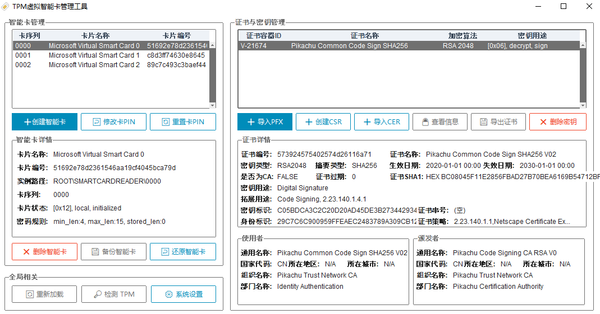

<div align="center">

# TPM Virtual-Smartcard-Manager

_Ein grafisches Werkzeug zum Erstellen und Verwalten virtueller TPM-Smartcards unter Windows_




Virtuelle Smartcards auf TPM-Basis bieten eine Sicherheit, die physischen Karten nahekommt: Der private Schlüssel wird vom TPM geschützt und niemals im Klartext exportiert

Schlüssel und CSR lassen sich lokal erzeugen, Zertifikate sicher aus der Cloud bereitstellen – als Ersatz für die PIV-Nutzung physischer Karten wie YubiKey oder ePass


[](../LICENSE)
[](https://github.com/PIKACHUIM/TPMSmartCard/actions/workflows/build-client-release.yml)
[](https://github.com/PIKACHUIM/TPMSmartCard/releases)
[](#-anforderungen)

🌐 [Online-Dokumentation](https://pikachuim.github.io/TPMSmartCard/)  · 🧭 [Architektur](../docs/architecture.md) · 💾 [Entwurf Sicherung/Wiederherstellung](../docs/design-backup-restore.md) · 🛠️ [Fehlerbehebung](../docs/troubleshooting.md) · 🔐 [Sicherheitsmodell](../docs/security.md)

[English](README_en.md) | [简体中文](../README.md) | [繁體中文](README_zh-Hant.md) | [日本語](README_ja.md) | [한국어](README_ko.md)<br>Deutsch | [Français](README_fr.md) | [Italiano](README_it.md) | [Português](README_pt.md) | [Русский](README_ru.md) | [Español](README_es.md)
</div>

---

## ✨ Funktionen

### Karten und Anmeldeinformationen

* **Virtuelle Smartcards**: Karten erstellen und löschen; PIN, PUK und Administratorschlüssel ändern oder zurücksetzen
* **Zertifikate und Schlüssel**: X.509-Zertifikate und Schlüsselobjekte auf der Karte importieren, löschen und anzeigen; Zertifikatskette und Schlüsselverwendung prüfen
* **Erzeugung und Bereitstellung**: Schlüssel + CSR lokal erzeugen und signieren lassen oder Zertifikate sicher aus der Cloud beziehen (X25519-Schlüsselvereinbarung + AES-Verschlüsselung)

### Sicherung und Wiederherstellung

* **Vollständige Kartensicherung**: packt eine Karte in eine `.tsb`-Datei (Kartendaten + Geräteregistrierung + TPM-Schlüsselindex + Geräteeigenschaften + DPAPI-Klartext)
* **Wiederherstellung nur auf demselben TPM**: eine Sicherung lässt sich ausschließlich auf dem **selben TPM** wiederherstellen (Neuinstallation von Windows auf diesem Rechner: ja; **anderer Rechner / anderes TPM: nein**, und **eine gelöschte Karte kann nicht wiederhergestellt werden**)
* DPAPI-Daten werden beim Sichern entschlüsselt und beim Wiederherstellen mit dem lokalen Hauptschlüssel neu verschlüsselt (siehe [Entwurf Sicherung/Wiederherstellung](../docs/design-backup-restore.md))
* **Diagnose der Wiederherstellung**: nach der Wiederherstellung prüft das Werkzeug die drei Ebenen Geräteknoten / PC-SC-Leser / DPAPI und liefert eine umsetzbare Schlussfolgerung samt Protokoll

### Szenarien und Werkzeuge

* **SSH2-Anmeldung**: mit WinCryptSSHAgent den privaten Schlüssel der Karte für die Anmeldung an entfernten Servern nutzen
* **Umgebungswerkzeuge**: OpenSC und SSH-Agent installieren / starten, TPM-Status anzeigen, Zertifikate und öffentliche Schlüssel exportieren
* **Mehrsprachige Oberfläche**: 11 Sprachen (简体中文 / 繁體中文 / English / 日本語 / 한국어 / Deutsch / Français / Italiano / Português / Русский / Español)

---

## 🚀 Schnellstart

1. Laden Sie `TPMSmartCard-*-setup.exe` (oder das portable ZIP) von [Releases](https://github.com/PIKACHUIM/TPMSmartCard/releases) herunter und installieren Sie es;
2. **Als Administrator ausführen** (Registrierung der Kartengeräte sowie Lesen/Schreiben von Systemordnern erfordern Administratorrechte);
3. Unter „Kartenverwaltung“ eine Karte erstellen → Zertifikat importieren oder erzeugen → (optional) unter „Systemeinstellungen“ den SSH-Agent installieren und starten;
4. Sicherung: Karte auswählen → Sichern, ergibt eine `.tsb`-Datei; Wiederherstellung: `.tsb` auswählen → Wiederherstellen.

> [!IMPORTANT]
> **Virtuelle Smartcards können nicht in einer Sitzung für Remotedesktop (Terminaldienste) erstellt oder gelöscht werden**; Windows lehnt dies mit `0x800704d3` ab.
>
> Verwenden Sie die lokale Konsole oder verbinden Sie sich mit `mstsc /admin`.

> [!TIP]
> Die zum Lesen der Karten benötigten [OpenSC](https://github.com/OpenSC/OpenSC/releases)-Werkzeuge sind **im Programm enthalten** (Ordner `OpenSC` neben dem Programm),
> eine separate Installation ist also nicht nötig; die systemweite OpenSC-Komponente im Installationsprogramm ist optional und nützt nur anderer Software (PKCS#11-Clients, Minidriver für physische Karten usw.).

---

## 🧩 Anforderungen

| Punkt | Anforderung |
|---|---|
| System | Windows 8 x86 / x64 oder höher (**Administratorrechte erforderlich**) |
| Hardware | TPM 1.2 / 2.0 oder höher |
| Systemkomponenten | `tpmvscmgr`, `certutil` (in Windows enthalten) |
| Mitgelieferte Komponenten | OpenSC-Werkzeuge, WinCryptSSHAgent, `Import` (.NET-Werkzeug zum Zertifikatsimport) |

---

## 🏗️ Architektur

| Aspekt | Wert |
|---|---|
| Sprache / Laufzeit | Python **3.11** |
| Oberfläche | Tkinter + ttkbootstrap (Oberfläche vollständig im Code aufgebaut; Layouts durch `Config/*.json` gesteuert) |
| Kartenoperationen | `tpmvscmgr` (Erstellen / Löschen / PIN ändern) + OpenSC (Karten- und Zertifikatslesen) + eigene PnP-/SetupAPI-Ebene |
| Sicherung und Wiederherstellung | eigenes `.tsb`-Format (ZIP); `Module/DPAPI.py` übernimmt DPAPI-Ver- und -Entschlüsselung sowie Token-Impersonation |
| Paketierung | zwei Pipelines: **cx_Freeze** (Release-Builds, Installer über Inno Setup) und **Nuitka** (Standalone-Ordner) |
| Lokalisierung | `Config/locales/*.json`, 11 Sprachen |

---

## 🛠️ Entwicklung und Build

```bash
# 1. Python-3.11-Umgebung vorbereiten (ein Hilfsskript liegt bei)
powershell -File Builds\NewVenv-PY313.ps1

# 2. Abhängigkeiten installieren
pip install -r requirements.txt

# 3. Direkt aus dem Quellcode starten (Administratorrechte erforderlich)
python SmartCardAPP.py

# 4. Bauen
python BuildPackage.py build      # cx_Freeze: drei Programme + mitgelieferte Ressourcen
python BuildNuitka.py             # Nuitka: build/nuitka/TPMSmartCard/
```

* Selbstprüfung der Abhängigkeiten: `python Builds/check_imports.py`
* Vollständige Entwicklungsanleitung (Ausführen, Paketieren, Signieren, CI, Debugging auf echter Hardware): [Entwicklungsanleitung](../docs/dev-guide.md)
* Codestruktur und Aufgaben der Module: [Architektur](../docs/architecture.md)

---

## 💾 Sicherung und Wiederherstellung

Eine nutzbare virtuelle TPM-Smartcard besteht aus **fünf Teilen**, und die `.tsb`-Datei enthält alle:

| Teil | Inhalt | Wenn er fehlt |
|---|---|---|
| Karten-Datenordner | `Tpm\<store GUID>\` (Dateisystem der Karte sowie Schlüssel-/PIN-Zuordnungen) | Karte ohne Inhalt |
| Geräteregistrierung | `ROOT\SMARTCARDREADER\<Instanz>` und zugehörige Schlüssel | Geräteknoten lässt sich nicht erstellen |
| TPM-Schlüsselindex | `*.PCPKEY` (3 mögliche Ordner) | Treiber findet die Kartenschlüssel nicht |
| Geräteeigenschaften | Kartenname, Karten-GUID, Store-Bindung (ACL-geschützt; Registrierungsexport liest sie nicht) | Leser wird nicht an PC/SC veröffentlicht |
| DPAPI-Klartext | Klartext von `keymaps` / `pinmaps` / `pinpolicy` / `blobs\*` (wird auf dem Zielrechner neu verschlüsselt) | Zertifikate und privater Schlüssel erscheinen nicht |

> [!WARNING]
> Da der letzte Punkt enthalten ist, **entspricht eine `.tsb`-Datei dem Schlüsselmaterial der Karte**: bewahren Sie sie offline auf und legen Sie sie nicht in Versionsverwaltung, Cloud-Speicher oder Chat-Tools ab.
>
> Bei der Wiederherstellung verschlüsselt das Werkzeug sie mit dem DPAPI des Zielrechners neu, bevor sie zurückgeschrieben wird; bewahren Sie ebenso Kartenname, PIN, PUK und Administratorschlüssel auf.

Weitere Hinweise:

* **Voraussetzungen**: es muss dasselbe **TPM** sein (Neuinstallation auf diesem Rechner: ja; anderer Rechner oder anderes TPM: nein)
* Beim Löschen einer Karte wird auch ihr persistenter TPM-Schlüssel entfernt; **danach hilft auch eine Sicherung nicht mehr**;
* Nach der Wiederherstellung **kann ein Neustart des Geräts (Treibers) oder von Windows nötig sein**, bis die Karte in der Leserliste erscheint;

---

## ❓ Häufige Fragen

> **F: Warum schlägt das Erstellen einer Karte in einer Remotedesktop-Sitzung mit `0x800704d3` fehl?**
>
> A: Windows verbietet das Erstellen / Löschen virtueller Smartcards in einer Terminaldienstesitzung. Nutzen Sie die lokale Konsole oder `mstsc /admin`.
>
> **F: Kann eine Sicherung auf einem anderen Rechner wiederhergestellt werden?**
>
> A: **Nein.** Eine Sicherung gilt nur für dasselbe **TPM**: nach einer Neuinstallation auf diesem Rechner ja, auf einem anderen Rechner oder mit einem anderen TPM nein; eine **gelöschte Karte**
>
> **kann nicht wiederhergestellt werden** (beim Löschen wird ihr persistenter TPM-Schlüssel entfernt). Erscheint die Karte nach der Wiederherstellung nicht, starten Sie zuerst das Gerät bzw. das System neu.
>
> **F: Die Karte erscheint nach der Wiederherstellung nicht – was tun?**
>
> A: **Zuerst neu starten**: Die Karte erscheint unter Umständen erst nach einem **Neustart des Geräts (Treibers) oder von Windows** in der Leserliste. Erscheint sie danach immer noch nicht,
>
> sehen Sie das dreistufige Urteil im Protokoll an (Geräteknoten / Leser / DPAPI): meist liegt es an einer Sicherung aus einer älteren Version oder an fehlenden Identitätseigenschaften der Karte.
>
> **F: Nach der Wiederherstellung erscheint kein Leser oder keine Zertifikate – was tun?**
>
> A: Sehen Sie sich das dreistufige Urteil im Protokoll an (Geräteknoten / Leser / DPAPI). Häufigste Ursachen sind eine Sicherung aus einer älteren Version oder fehlende Identitätseigenschaften der Karte;
>
> folgen Sie der [Fehlerbehebungsanleitung](../docs/troubleshooting.md) oder hängen Sie das Protokoll an ein Issue an.
>
> **F: Ist eine Netzwerkverbindung nötig?**
>
> A: Alles funktioniert offline, außer der „Zertifikatsbereitstellung aus der Cloud“.
>
> **F: Die Zertifikatskette meldet `CERT_E_CHAINING`.**
>
> A: Die ausstellende Zwischen-CA ist auf diesem Rechner nicht installiert; importieren Sie sie in den Speicher für vertrauenswürdige Stamm-/Zwischenzertifikate.

---

## 🤝 Support

* 🐛 **Fehler oder Funktionswünsche**: bitte ein [Issue](https://github.com/PIKACHUIM/TPMSmartCard/issues) öffnen (Protokolle aus `%APPDATA%\TPMSmartCard\logs\` anhängen)
* 💬 **Fragen zur Nutzung**: ebenfalls willkommen in den Issues

---

## 📄 Lizenz

Dieses Projekt steht unter der **GPL-3.0**-Lizenz. Siehe [LICENSE](../LICENSE).

## 🙏 Referenzierte Projekte

1. [OpenSC/OpenSC](https://github.com/OpenSC/OpenSC) — Open-Source-Werkzeuge und Middleware für Smartcards
2. [Microsoft Docs: Virtual Smart Cards](https://github.com/MicrosoftDocs/windows-itpro-docs/tree/public/windows/security/identity-protection/virtual-smart-cards)
3. WinCryptSSHAgent — SSH-Agent auf Basis privater Smartcard-Schlüssel


