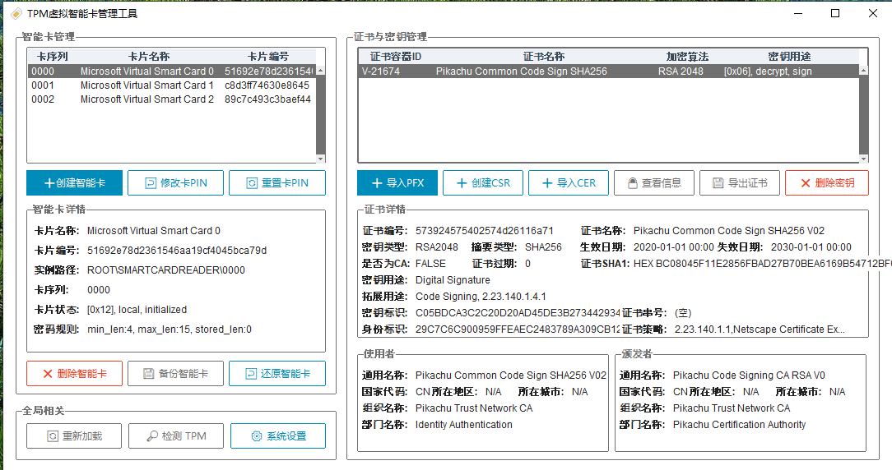

<div align="center">
# TPM 虛擬智慧卡管理員

_一款在 Windows 上建立與管理 TPM 虛擬智慧卡的圖形化工具_




以 TPM 為基礎的虛擬智慧卡提供接近實體智慧卡的強度，私鑰由 TPM 保護、始終不以明文匯出

支援在本機產生金鑰與 CSR，以及從雲端安全下發憑證，可替代 YubiKey、ePass 等實體卡的 PIV 需求


[](../LICENSE)
[](https://github.com/PIKACHUIM/TPMSmartCard/actions/workflows/build-client-release.yml)
[](https://github.com/PIKACHUIM/TPMSmartCard/releases)
[](#-系統需求)

📘 [文件索引](../docs/README.md) · 🧭 [架構說明](../docs/architecture.md) · 💾 [備份還原設計](../docs/design-backup-restore.md) · 🛠️ [疑難排解](../docs/troubleshooting.md) · 🔐 [安全模型](../docs/security.md)

[English](README_en.md) | [简体中文](../README.md) | 繁體中文 | [日本語](README_ja.md) | [한국어](README_ko.md)<br>[Deutsch](README_de.md) | [Français](README_fr.md) | [Italiano](README_it.md) | [Português](README_pt.md) | [Русский](README_ru.md) | [Español](README_es.md)
</div>
---

## ✨ 功能

### 卡片與憑證

* **虛擬智慧卡**：建立、刪除卡片，修改 / 重設 PIN、PUK 與管理金鑰
* **憑證與金鑰**：匯入、刪除、檢視 X.509 憑證與卡上金鑰物件，檢視憑證鏈與金鑰用途
* **產生與下發**：在本機產生金鑰 + CSR 後簽發；或從雲端安全下發（X25519 金鑰協商 + AES 加密，取件碼以帶外方式傳遞）

### 備份與還原

* **整卡備份**：把一張卡完整打包成 `.tsb`（卡片資料 + 裝置登錄檔 + TPM 金鑰索引 + 裝置屬性 + DPAPI 明文）
* **同 TPM 還原**：只能在同一顆 TPM 上還原（在本機重裝系統後可以；**換機器 / 換 TPM 不行**，**刪除卡片後也無法還原**）；DPAPI 資料在備份時解開、還原時用本機主金鑰重新加密（詳見 [備份還原設計](../docs/design-backup-restore.md)）
* **還原診斷**：還原後自動判定裝置節點 / 讀卡機 / DPAPI 三層狀態，並給出可執行的結論與日誌

### 情境與工具

* **SSH2 登入**：搭配 WinCryptSSHAgent 使用卡上私鑰登入遠端伺服器
* **環境工具**：安裝 / 啟動 OpenSC 與 SSH 代理、檢視 TPM 狀態、匯出憑證與公鑰
* **多語言介面**：11 種語言（简体中文 / 繁體中文 / English / 日本語 / 한국어 / Deutsch / Français / Italiano / Português / Русский / Español）

---

## 🚀 快速開始

1. 到 [Releases](https://github.com/PIKACHUIM/TPMSmartCard/releases) 下載 `TPMSmartCard-*-setup.exe`（或綠色版 zip）並安裝；
2. **以管理員身分執行**（註冊卡片裝置、讀寫系統目錄都需要管理員權限）；
3. 在「卡片管理」中建立卡片 → 匯入或產生憑證 →（可選）在「系統設定」中安裝並啟動 SSH 代理；
4. 備份：選取卡片 → 備份，得到 `.tsb`；還原：選取 `.tsb` → 還原。

> [!IMPORTANT]
> **建立 / 刪除虛擬智慧卡不能在遠端桌面（終端機服務）工作階段中進行**，Windows 會拒絕並傳回 `0x800704d3`。
> 請到本機主控台操作，或用 `mstsc /admin` 連線到主控台工作階段。

> [!TIP]
> 讀卡所需的 [OpenSC](https://github.com/OpenSC/OpenSC/releases) 工具**已隨程式散布**（程式目錄的 `OpenSC` 資料夾），
> 無需另外安裝；安裝程式中的系統級 OpenSC 元件是選用項目，僅供其它軟體使用（PKCS#11 用戶端、實體卡 minidriver 等）。

---

## 🧩 系統需求

| 項目 | 需求 |
|---|---|
| 系統 | Windows 8 x86 / x64 或更高（**需要管理員權限**） |
| 硬體 | TPM 1.2 / 2.0 或更高 |
| 系統元件 | `tpmvscmgr`、`certutil`（系統內建） |
| 隨包元件 | OpenSC 工具、WinCryptSSHAgent、`Import`（.NET 憑證匯入工具） |

---

## 🏗️ 技術架構

| 面向 | 取值 |
|---|---|
| 語言 / 執行環境 | Python **3.11** |
| 介面 | Tkinter + ttkbootstrap（介面完全以程式碼建構，版面由 `Config/*.json` 驅動） |
| 卡片操作 | `tpmvscmgr`（建立 / 刪除 / 變更 PIN）+ OpenSC（讀卡與憑證）+ 自研 PnP / SetupAPI 層（裝置節點與屬性） |
| 備份還原 | 自研 `.tsb`（zip）封裝；`Module/DPAPI.py` 負責 DPAPI 加解密與權杖借用 |
| 封裝 | 兩條流水線：**cx_Freeze**（正式包，Inno Setup 產生安裝程式）與 **Nuitka**（standalone 目錄） |
| 多語言 | `Config/locales/*.json`，11 種語言 |

---

## 🛠️ 開發建置

```bash
# 1. 準備 Python 3.11 環境（建議用倉庫自帶指令碼重建 venv）
powershell -File Builds\NewVenv-PY311.ps1

# 2. 安裝相依套件
pip install -r requirements.txt

# 3. 直接從原始碼執行（需要管理員權限）
python SmartCardAPP.py

# 4. 封裝
python BuildPackage.py build      # cx_Freeze：三個 exe + 隨包資源
python BuildNuitka.py             # Nuitka：build/nuitka/TPMSmartCard/
```

* 相依性自查：`python Builds/check_imports.py`
* 完整開發說明（執行方式、封裝、簽章、CI、真機偵錯方法）：[開發與偵錯指南](../docs/dev-guide.md)
* 程式結構與模組職責：[架構說明](../docs/architecture.md)

---

## 💾 備份還原

一張可用的 TPM 虛擬智慧卡由**五個部分**共同構成，`.tsb` 會把這五個部分全部收進包裡：

| 組成 | 內容 | 缺少的後果 |
|---|---|---|
| 卡片資料目錄 | `Tpm\<store GUID>\`（卡內檔案系統與金鑰 / PIN 對應） | 卡片沒有內容 |
| 裝置登錄檔 | `ROOT\SMARTCARDREADER\<實例>` 等 | 裝置節點建不出來 |
| TPM 金鑰索引 | `*.PCPKEY`（3 個候選目錄） | 驅動程式找不到卡上金鑰 |
| 裝置屬性 | 卡片名稱、卡片 GUID、store 綁定（受 ACL 保護，登錄檔匯出拿不到） | 讀卡機不會發布到 PC/SC |
| DPAPI 明文 | `keymaps` / `pinmaps` / `pinpolicy` / `blobs\*` 的明文（還原時用目標機重新加密） | 憑證與私鑰不會顯示 |

> [!WARNING]
> 因為包含上表最後一項，**`.tsb` 等同於卡片金鑰材料**：請離線妥善保管，不要放進版本庫、雲端硬碟或聊天工具。
> 還原時工具會用目標機的 DPAPI 重新加密後寫回；建議同時保管好卡片名稱、PIN、PUK 與管理金鑰。

其它說明：

* **還原前提**：必須**同一顆 TPM**（在本機重裝系統後可以還原；換機器、換 TPM 都不行），且**卡片沒有被刪除**
  —— 刪除卡片會清除它在 TPM 內的持久金鑰，刪除之後即使有備份也無法還原；
* 還原後**可能需要重新啟動裝置（驅動程式）或重新啟動系統**，卡片才會出現在讀卡機清單中；
* 舊版工具製作的 `.tsb` 不含「裝置屬性」與「DPAPI 明文」，用於還原會缺卡片身分、讀卡機不會出現，請用新版本重新備份。

---

## ❓ 常見問題

**Q：為什麼在遠端桌面中建立卡片會失敗，並回報 `0x800704d3`？**
A：Windows 禁止在終端機服務工作階段中建立 / 刪除虛擬智慧卡。請在本機主控台操作，或用 `mstsc /admin` 連線主控台工作階段。

**Q：備份能在別的機器上還原嗎？**
A：**不能**。備份只適用於**同一顆 TPM**：在本機重裝系統後可以還原，換機器或換 TPM 都不行；而且**卡片被刪除後**
**也無法還原**（刪除卡片會清除它在 TPM 內的持久金鑰）。還原後若卡片沒出現，先重新啟動裝置或系統再試。

**Q：還原後讀卡機沒出現 / 憑證不顯示怎麼辦？**
A：先看還原日誌的三層判定（裝置節點 / 讀卡機 / DPAPI）。常見原因是「用舊版備份的包」或缺卡片身分屬性；
對照 [疑難排解手冊](../docs/troubleshooting.md) 逐步判定，或把日誌發到 Issues。

**Q：需要連線網路嗎？**
A：除「雲端下發憑證」外全部可離線使用。

**Q：憑證鏈回報 `CERT_E_CHAINING`？**
A：簽發該憑證的中繼 CA 沒安裝在目前機器上，把它匯入「受信任的根 / 中繼憑證」即可。

---

## 🤝 協助支援

* 🐛 **Bug 或功能請求**：請到 [Issues](https://github.com/PIKACHUIM/TPMSmartCard/issues) 提交（附上 `%APPDATA%\TPMSmartCard\logs\` 下的日誌）
* 💬 **使用問題**：也歡迎在 Issues 中討論

---

## 📄 開源授權

本專案以 **GPL-3.0** 授權條款開源，詳見 [LICENSE](../LICENSE)。

## 🙏 參考

1. [OpenSC/OpenSC](https://github.com/OpenSC/OpenSC) —— 開源智慧卡工具與中介軟體
2. [Microsoft Docs: Virtual Smart Cards](https://github.com/MicrosoftDocs/windows-itpro-docs/tree/public/windows/security/identity-protection/virtual-smart-cards)
3. WinCryptSSHAgent —— 以智慧卡私鑰做 SSH 認證的代理程式


